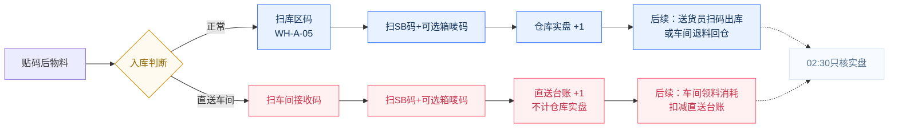
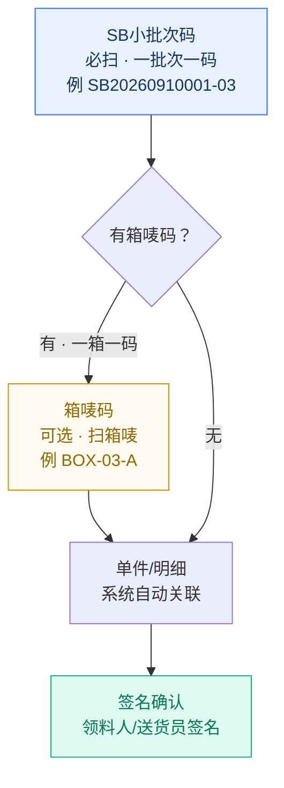
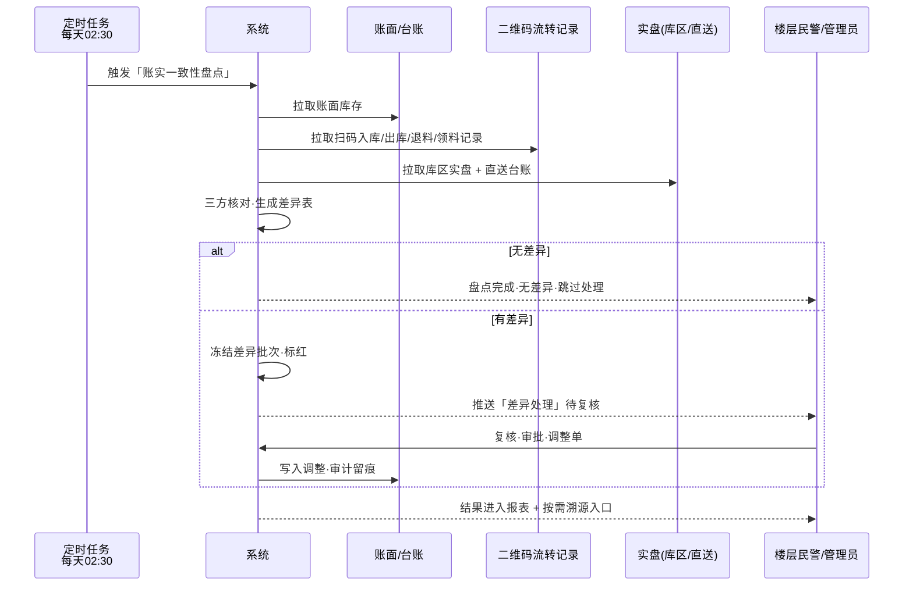

# 物料管理 · 一期流程图（V2.0 · 2026-09-10）

> **范围：** 一期只做物料管理闭环，不含生产排产/班组考核等二期内容  
> **口径：** 主批次→小批次→二维码（≤2KB，一物一码）→ 账卡物一致，纸电双轨留痕  
> **V2.0 变更：** ① 退料定义澄清 ② 出货→送货员扫码出库 ③ 领料改为扫码+签名+箱唛可选 ④ 凌晨盘点与溯源改为“有错才溯源”按需触发

---

## 0. 本次优化点（回答你的 3 个问题）

| 你的问题 | 优化结论 |
|---------|---------|
| **11的退料是什么意思？** | **退料 = 车间已领但未用完的物料退回仓库。** 不是出库，是反向回仓。场景：车间领 100 套只用 80 套，剩下 20 套扫码退回，仓库库存回增，消耗只计 80。系统拦截超领/超退，必须扫码+签名才生效。 |
| **出货改成送货员扫码出库 / 12改成车间领料扫码+签名+箱唛** | 已改。`11. 送货员扫码出库 / 车间退料回仓`（送货员发成品给客户或车间退料回仓，都要扫码+签名）。`12. 车间领料扫码并签名` 层级改为 `SB小批次码（必扫）→ 箱唛码（可选，一箱一码）→ 单件`，签名后才扣减账面。 |
| **凌晨盘点/差异/流转追溯/报表是什么意思？p那些？** | **13 凌晨自动盘点** = 每天 02:30 定时任务自动跑，核对 `账面库存 vs 二维码流转记录 vs 实盘`，生成差异表。**14 差异处理** = 有差异才进冻结→复核→审批，无差异直接跳过。**15 流转追溯** = **有错误才触发**，按需追到具体人/码/时间/操作（不是每批必走）。**16 报表分析** = 按天/周/月汇总收发存、损耗、库龄，供复核。 |

---

## 0.1 名词解释

- **退料（回仓）：** 车间从仓库领料后，因计划变更/多领/质量问题把剩余物料退回仓库。扫 `物料码+退料单`，仓库库存增加，车间消耗扣减，需领料人+仓库管理员双签名。
- **送货员扫码出库：** 成品或物料发往客户/下级仓，由**送货员**扫 `物料/成品码 + 出库单` 并签名，扣减对应台账（仓库实盘或直送台账）。
- **箱唛码（可选）：** 贴在物料箱/包外层的箱唛二维码，一箱一码，SB 小批次下可含多箱。扫码层级：`SB小批次码（必选）> 箱唛码（可选）> 单件码`。有箱唛就多扫一码，没有可跳过。
- **凌晨自动盘点：** 系统每天 02:30 自动执行的 `账实一致性核对` 定时任务，无需人工发起，失败可重试，结果需人工复核才闭环。
- **流转追溯（按需）：** 出错时才触发，串联 `MB主批次→SB小批次→(箱唛)→库区/车间→出库/退料→领料` 的时间线，定位到 `谁、什么时间、扫了什么码、签了什么单`。
- **报表分析：** 在差异闭环后自动汇总，报表草稿需人工复核才发布。

---

## 1. 总览流程图（Mermaid · V2.0）

```mermaid
flowchart TD
    classDef start fill:#2f6bff,stroke:#174ee5,color:#fff,stroke-width:2px
    classDef step fill:#ffffff,stroke:#d9e6f5,color:#16365d,stroke-width:1.5px
    classDef check fill:#f0f5ff,stroke:#2f6bff,color:#174ee5,stroke-width:1.5px
    classDef decision fill:#fffaf0,stroke:#d58b00,color:#8f6900,stroke-width:1.5px
    classDef direct fill:#fff0f2,stroke:#ff5d73,color:#c9344a,stroke-width:1.5px
    classDef auto fill:#ddfaef,stroke:#16a87a,color:#087857,stroke-width:1.5px
    classDef trace fill:#f2eaff,stroke:#7c3aed,color:#4a1ea8,stroke-width:1.5px
    classDef end fill:#102f5f,stroke:#38ddf7,color:#fff,stroke-width:2px

    A([开始<br/>供应商送货]):::start --> B[1. 二维码主批次生成<br/>MB-批次号]:::step
    B --> C[2. 小批次赋码<br/>按箱/包自由拆分 SB-xxx 二维码≤2KB]:::step
    C --> D[3. 打印二维码标签]:::step
    D --> E[4. OCR/人工录入<br/>①扫送货单 ②拍箱唛 ③手动补录]:::check
    E --> F[5. 系统自动检验核对<br/>送货单 vs 箱唛 vs 手动]:::auto
    F --> G{6. 是否一致？}:::decision
    G -- 是 --> H[7. 整体物料表签名确认]:::step
    G -- 否 --> G1[差错清单标红]:::decision
    G1 --> G2[人工逐项打 √]:::step
    G2 --> G3{复核通过？}:::decision
    G3 -- 否 --> G1
    G3 -- 是 --> H
    H --> I[8. 贴二维码<br/>箱/包实物贴码]:::step
    I --> J{9. 是否直送车间？}:::decision
    J -- 否·正常入库 --> K[10a. 扫码入库<br/>先扫库区码→再扫物料码]:::step
    J -- 是·直送车间 --> K2[10b. 直送车间<br/>不计仓库实盘·直送台账]:::direct
    K --> L[11. 送货员扫码出库<br/>/ 车间退料回仓<br/>扫码+签名确认]:::step
    K2 --> L
    L --> M[12. 车间领料扫码并签名<br/>SB码必扫 → 箱唛码可选 → 签名]:::step
    M --> M1{领料与工单<br/>数量/批次一致？}:::decision
    M1 -- 否·有差错 --> T1[按需溯源<br/>追到领料人·码·时间]:::trace
    M1 -- 是 --> N

    N[13. 凌晨02:30定时自动盘点<br/>账面 vs 流转 vs 实盘]:::auto --> O{有差异？}:::decision
    O -- 无差异 --> P[14. 跳过差异处理]:::step
    O -- 有差异 --> O1[14. 差异处理<br/>冻结·复核·审批]:::decision
    O1 --> Q
    P --> Q
    T1 --> Q

    Q{本批次是否<br/>出现过差错/差异？}:::decision
    Q -- 是·有错才溯源 --> Q1[15. 流转追溯<br/>精确到操作：谁·何时·扫何码·签何单]:::trace
    Q -- 否·无错不溯源 --> R
    Q1 --> R[16. 报表分析<br/>收发存·损耗·库龄]:::step
    R --> S([闭环完成]):::end

    linkStyle default stroke:#7890aa,stroke-width:1.5px
```

> **读图要点：** 11=出库与退料是同一节点的两个方向（发出去 vs 退回来）；12 领料必签名且支持箱唛可选；13 凌晨盘点是系统自动跑；15 溯源是**菱形判断后按需进入**，无错直接进报表。

---

## 2. 分支细节：入库 vs 直送（库存口径）



> **口径红线：** `WH-*` 实盘 ≠ `DM-*` 直送台账；报表分开展示，合计仅用于经营分析，不用于实盘对账。

---

## 3. 扫码层级：SB 小批次 → 箱唛（可选）→ 单件



> 有箱唛就多扫一次，没有可跳过；系统始终以 SB 为主键，箱唛为子级明细。

---

## 4. 车间领料扫码时序（SB + 可选箱唛 + 签名）

```mermaid
sequenceDiagram
    participant P as 车间领料员
    participant S as PDA
    participant SB as SB小批次码
    participant BOX as 箱唛码(可选)
    participant SYS as 系统
    participant LEDGER as 台账

    P->>S: 进入「车间领料」页·选择工单
    S->>SB: 扫SB码
    SB-->>SYS: 解析 SB + 校验已入库/直送有效
    alt 有箱唛
        S->>BOX: 扫箱唛码
        BOX-->>SYS: 校验箱唛归属SB
    end
    SYS->>SYS: 校验：工单匹配·数量未超领·批次一致
    alt 校验不一致
        SYS-->>P: 标红差错·触发按需溯源入口
    else 校验一致
        P->>SYS: 电子签名确认
        SYS->>LEDGER: 扣减账面·写入领料单·recordAudit留痕
        SYS-->>P: Toast「领料成功」+ 库存实时刷新
    end
```

---

## 5. 凌晨自动盘点时序（02:30 定时任务）



---

## 6. 何时触发“流转追溯”

| 触发点 | 触发条件 | 追到什么（具体到操作） |
|-------|---------|----------------------|
| **6. 入库前核对不一致** | 送货单 vs 箱唛 vs 手动不一致，且人工打√后仍有疑问 | 谁录的单、OCR哪一行错、谁打的√、谁签的字 |
| **12. 车间领料不一致** | 领料数量/批次/箱唛与工单不符 | 领料人、PDA扫码记录（SB+箱唛）、工单号、签名时间 |
| **13-14. 凌晨盘点有差异** | 账面 vs 流转 vs 实盘对不上 | 入库人、出库/退料送货员、领料人、库区码、时间线 |
| **无上述错误** | 全程一致 | **不触发溯源**，直接进报表分析 |

> 原则：**有错才溯源，无错不打扰**；溯源视图为时间线：`MB→SB→(箱唛)→库区/车间→送货员出库/退料→车间领料`，每一步显示 `操作人·扫码内容·签名·时间`。

---

## 7. 12 步明细表（V2.0 输入→输出）

| 步骤 | 名称 | 输入 | 系统动作 | 输出/凭证 | 责任岗 | 异常回流 |
|-----|------|------|----------|-----------|--------|----------|
| 1 | **主批次生成** | 送货单/订单 | 生成 `MB-` 批次号 | 主批次档案 | 外仓管理员 | — |
| 2 | **小批次赋码** | 主批次数量/包装 | 自由拆分 SB 二维码≤2KB | SB 数据 | 外仓管理员 | — |
| 3 | **打印标签** | SB 数据 | 标签打印预览 | 不干胶标签 | 外仓管理员 | 重打 |
| 4 | **OCR/人工录入** | 送货单照片+箱唛照片+手动 | OCR识别→结构化 | 结构化单据 | 外仓管理员 | 识别失败转人工 |
| 5 | **自动检验核对** | 三方比对 | 数量/规格/批次/供应商逐项比对 | 校验结果 | 系统自动 | — |
| 6 | **差错复核打√** | 差错清单 | 标红+逐项打√ | 复核后清单 | 外仓管理员+复核人 | 未打√不可签名 |
| 7 | **整体签名确认** | 复核后清单 | 电子+纸质签名 | 已确认物料表 | 责任人/民警 | 驳回重核 |
| 8 | **贴码** | 标签+实物 | 实物贴码 | 一物一码实物 | 外仓管理员 | 漏贴补贴 |
| 9a | **扫码入库** | 库区码+SB码(+箱唛可选) | 先扫库区→再扫物料 | 入库单·库区库存 | 外仓管理员 | 顺序错/重复拦截 |
| 9b | **直送车间** | 车间接收码+SB码 | 写入直送台账不计实盘 | 直送签收单 | 物料领发员/车间接收人 | 签收异常退回 |
| 11 | **送货员扫码出库 / 车间退料回仓** | 物料码+出库/退料单+签名 | 出库扣减 / 退料回增 | 出库单 / 退料单 | 送货员 / 车间+仓库双签 | 超领/超退拦截 |
| 12 | **车间领料扫码并签名** | SB码(+箱唛可选)+工单+签名 | 校验工单匹配→扣减账面 | 领料单 | 车间领料员 | 不一致→按需溯源 |
| 13 | **凌晨定时自动盘点** | 账面+流转+实盘 | 每天02:30自动核对 | 盘点差异表 | 系统定时任务 | 失败可重试 |
| 14 | **差异处理** | 差异表 | 冻结→复核→调整审批 | 调整单+审计日志 | 楼层民警/管理员 | 未闭环不可结账 |
| 15 | **流转追溯（按需）** | MB/SB/箱唛全链路 | 时间线串联，定位到操作 | 追溯视图 | 任意授权岗 | 仅有错时触发 |
| 16 | **报表分析** | 收发存/损耗/库龄 | 日/周/月汇总 | 库存日报等 | 系统+人工复核 | 缺口标黄 |

---

## 8. 页面映射（当前代码）

| 流程节点 | 对应页面/组件 | 文件 |
|----------|--------------|------|
| 主批次生成 | `主批次建档`（OCR辅助） | `pages-material.js` |
| 小批次赋码 | `小批次赋码`（拆分+二维码+打印预览） | `pages-material.js` |
| 打印/贴码 | 标签打印预览 | `pages-material.js` |
| OCR录入 | `OCR单据录入`（送货单+箱唛双录） | `pages-material.js` / `pages-ai.js` |
| 自动核对/差错打√/签名 | 物料清单校验弹窗 + `renderBusinessClosure` | `app.js` + `pages-material.js` |
| 扫码入库（库区码+SB+箱唛可选） | `库存信息` 批次展开 + 扫码入库 | `pages-warehouse.js` |
| 直送车间 | `物料直送车间`（DM台账） | `pages-direct.js` |
| 送货员扫码出库 / 退料回仓 | `物料出库 / 退料` | `pages-warehouse.js` / `pages-direct.js` |
| 车间领料（SB+箱唛可选+签名） | `流转记录` + 领料扫码 | `pages-material.js` |
| 凌晨自动盘点 | `定时任务与报告`（02:30账实盘点） | `pages-scheduled.js` |
| 差异处理 | `库存对账 / 库存冻结` | `pages-warehouse.js` |
| 流转追溯（按需） | `流转记录`时间线 + `五级溯源` | `pages-material.js` |
| 报表分析 | `报表中心`（库存/物料类） | `pages-reports.js` |

---

## 9. 关键规则（已在代码中落地）

1. **先扫库区码再扫物料码**才算有效入库；顺序错拦截。
2. **SB 必扫，箱唛可选**；有箱唛必须归属同一 SB，否则拦截。
3. **直送不计实盘**；`WH-*` 与 `DM-*` 分账，02:30 只核实盘。
4. **差错未打√不可签名**；领料不一致直接进按需溯源。
5. **有错才溯源**；无错批次跳过溯源直进报表，减少无效操作。
6. **软删除/软停用**；历史单据与二维码留痕不删。
7. **审计必留痕**；`recordAudit` 覆盖 1-16 每一步关键动作。

---

## 10. 导出建议

## 11. AI问数 Agent（一期建议）

AI问数作为全局只读助手，入口位于顶部导航/驾驶舱，不改变现有业务闭环。支持自然语言查询库存、收发存、领退料、报表、异常和物料流转追溯，并返回数据时间范围、口径和可下钻单据。

建议流程：`用户提问 → 权限校验 → 意图识别与条件抽取 → 查询业务数据 → 生成回答/图表 → 引用单据与追溯入口`。

Agent 只能查询、解释、汇总和打开页面；不得直接修改库存、完成调拨、关闭异常、替代签名审批。涉及客户、数量、批次、单位的回答必须展示明细来源；模型不可用时降级为普通搜索和报表筛选。

- Cursor 中按 `Ctrl+Shift+V` 预览，Mermaid 自动渲染
- 需导出图片：https://mermaid.live 粘贴第1节代码 → Export PNG/SVG
- 需打印：VS Code 安装 `Markdown Preview Enhanced` → 导出 PDF

> 本流程图为一期交付基准，二期在此主链路上扩展，不改变已定义的库存口径与审计约束。
